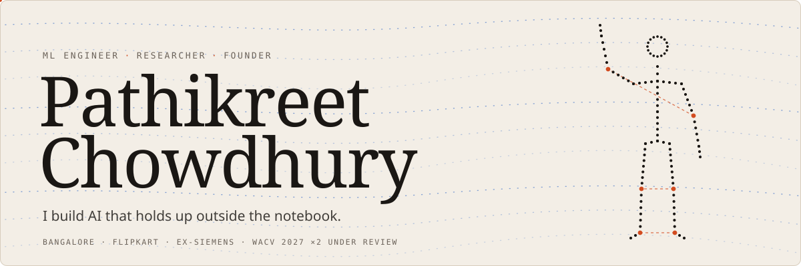

<a href="https://vayuputra2401.github.io/Personal-Portfolio/">
<picture>
  <source media="(prefers-color-scheme: dark)" srcset="assets/header-dark.svg">
  <source media="(prefers-color-scheme: light)" srcset="assets/header-light.svg">
  
</picture>
</a>

 

<a href="https://vayuputra2401.github.io/Personal-Portfolio/">PORTFOLIO</a> &nbsp;·&nbsp; <a href="https://www.linkedin.com/in/pathikreet-chowdhury-489b77234/">LINKEDIN</a> &nbsp;·&nbsp; <a href="https://www.kaggle.com/pathikreet">KAGGLE</a> &nbsp;·&nbsp; <a href="mailto:pathikreetofficial@gmail.com">EMAIL</a>

 

<picture>
  <source media="(prefers-color-scheme: dark)" srcset="assets/stats-dark.svg">
  <source media="(prefers-color-scheme: light)" srcset="assets/stats-light.svg">
  
</picture>

 

<a href="https://vayuputra2401.github.io/Personal-Portfolio/#building">
<picture>
  <source media="(prefers-color-scheme: dark)" srcset="assets/building-dark.svg">
  <source media="(prefers-color-scheme: light)" srcset="assets/building-light.svg">
  
</picture>
</a>

 

<a href="https://vayuputra2401.github.io/Personal-Portfolio/#research">
<picture>
  <source media="(prefers-color-scheme: dark)" srcset="assets/research-dark.svg">
  <source media="(prefers-color-scheme: light)" srcset="assets/research-light.svg">
  
</picture>
</a>

 

CODE &nbsp; <a href="https://github.com/Vayuputra2401/anatomy-is-free">Anatomy is Free</a> · <a href="https://github.com/Vayuputra2401/AMBETS">Aligned but Inert</a> · <a href="https://github.com/Vayuputra2401/FL-Face">FL-Face</a> · <a href="https://github.com/Vayuputra2401/ICPR-XAI-2024">ICPR-XAI</a>

 

<a href="https://vayuputra2401.github.io/Personal-Portfolio/#work">
<picture>
  <source media="(prefers-color-scheme: dark)" srcset="assets/work-dark.svg">
  <source media="(prefers-color-scheme: light)" srcset="assets/work-light.svg">
  
</picture>
</a>

 

<a href="https://vayuputra2401.github.io/Personal-Portfolio/#projects">
<picture>
  <source media="(prefers-color-scheme: dark)" srcset="assets/projects-dark.svg">
  <source media="(prefers-color-scheme: light)" srcset="assets/projects-light.svg">
  
</picture>
</a>

 

REPOS &nbsp; <a href="https://github.com/Vayuputra2401/AP-Clerk-Financial-Agent">AP Commander</a> · <a href="https://github.com/Radhika1124/ReLoop">ReLoop</a> · <a href="https://github.com/Vayuputra2401/TransformoDocs">TransformoDocs</a> · <a href="https://github.com/Vayuputra2401/MoleculeForge">MoleculeForge</a> · <a href="https://github.com/Vayuputra2401/Eir">Eir</a> · <a href="https://github.com/Vayuputra2401/LegalVoice.ai">LegalVoice.ai</a>

 

<picture>
  <source media="(prefers-color-scheme: dark)" srcset="assets/tools-dark.svg">
  <source media="(prefers-color-scheme: light)" srcset="assets/tools-light.svg">
  
</picture>

 

<a href="https://vayuputra2401.github.io/Personal-Portfolio/#contact">
<picture>
  <source media="(prefers-color-scheme: dark)" srcset="assets/footer-dark.svg">
  <source media="(prefers-color-scheme: light)" srcset="assets/footer-light.svg">
  
</picture>
</a>
